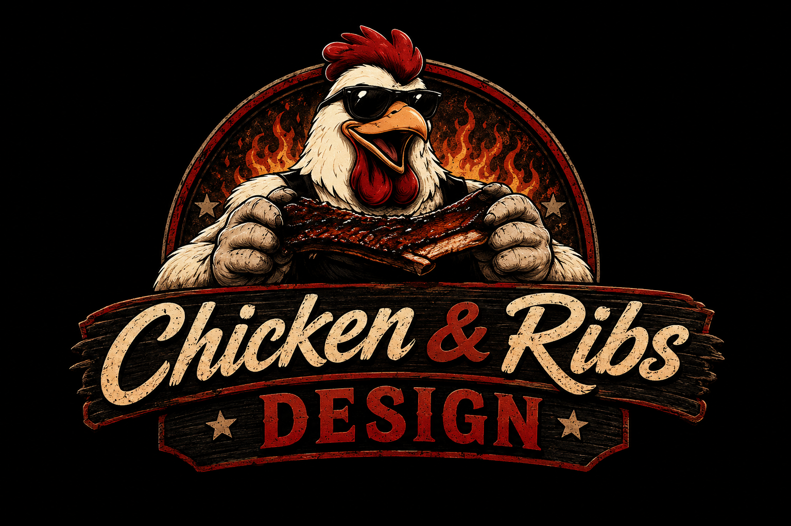

# chickenandribs OPCD Tools

Unity and Blender tools for building golf courses with
[OPCD](https://zerosandonesgcd.com/) (Open Platform Course Design) for
GSPro. Each tool lives in its own repository, linked below.

See [LICENSE.md](LICENSE.md) for usage terms and
[CONTRIBUTING.md](CONTRIBUTING.md) for the shared branch/release
conventions used across all of these repos.

## Released Tools

| Tool | Description |
|---|---|
| [MovingVehicles](https://github.com/mmoore0011/chickenandribs_movingvehicles) | Move vehicles (or any other kind of prefab) on a path through your scene |
| [meshgapdetector](https://github.com/mmoore0011/chickenandribs_meshgapdetector) | Find and fix your mesh gaps in Blender |
| [SkyDome](https://github.com/mmoore0011/chickenandribs_skydome) | Create a Truman-show style sky dome around your scene |
| [PanoramaCylinder](https://github.com/mmoore0011/chickenandribs_panorama_cylinder) | Take some of the manual work out of pano cylinder creation |

More tools are in active development and get added here once they're
ready for general use.

## Bug Reports / Feature Requests

Please open an issue in the relevant tool's own repository.
